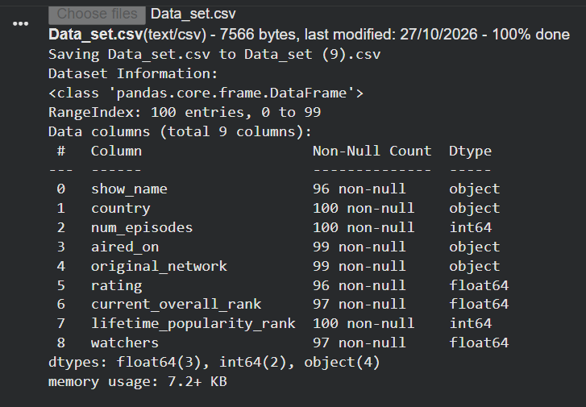
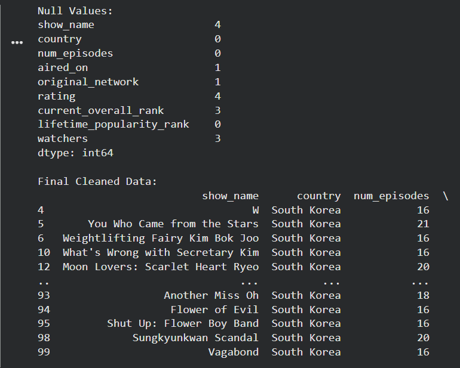
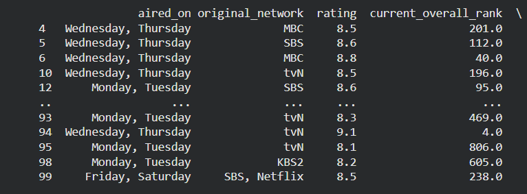
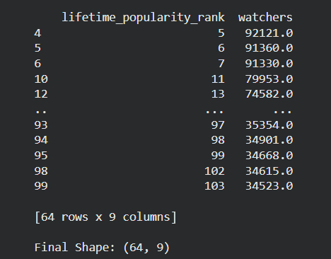
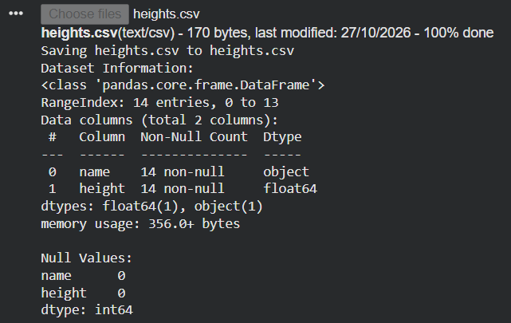
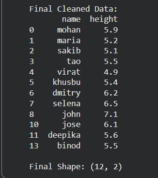

# Exno:1
Data Cleaning Process

# AIM
To read the given data and perform data cleaning and save the cleaned data to a file.

# Explanation
Data cleaning is the process of preparing data for analysis by removing or modifying data that is incorrect ,incompleted , irrelevant , duplicated or improperly formatted. Data cleaning is not simply about erasing data ,but rather finding a way to maximize datasets accuracy without necessarily deleting the information.

# Algorithm
STEP 1: Read the given Data

STEP 2: Get the information about the data

STEP 3: Remove the null values from the data

STEP 4: Save the Clean data to the file

STEP 5: Remove outliers using IQR

STEP 6: Use zscore of to remove outliers

# Coding and Output

# Data_set.csv

```
import pandas as pd
from scipy import stats
from google.colab import files

uploaded = files.upload()
filename = next(iter(uploaded))

df = pd.read_csv(filename)

print("Dataset Information:")
df.info()

print("\nNull Values:")
print(df.isnull().sum())

df = df.dropna()
df.to_csv("Cleaned_data.csv", index=False)

num = df.select_dtypes(include="number")
if not num.empty:
    Q1 = num.quantile(0.25)
    Q3 = num.quantile(0.75)
    IQR = Q3 - Q1

    df = df[~((num < Q1 - 1.5 * IQR) |
              (num > Q3 + 1.5 * IQR)).any(axis=1)]

num = df.select_dtypes(include="number")
if not num.empty and len(num) > 1:
    z = pd.DataFrame(stats.zscore(num), columns=num.columns,
                     index=num.index)
    df = df[(z.abs() < 3).all(axis=1)]

df.to_csv("Final_cleaned_data.csv", index=False)

print("\nFinal Cleaned Data:")
print(df)
print("\nFinal Shape:", df.shape)

files.download("Final_cleaned_data.csv")
```









# heights.csv 

```
import pandas as pd
from scipy import stats
from google.colab import files

uploaded = files.upload()
filename = next(iter(uploaded))

df = pd.read_csv(filename)

print("Dataset Information:")
df.info()

print("\nNull Values:")
print(df.isnull().sum())

df = df.dropna()
df.to_csv("Cleaned_data.csv", index=False)

num = df.select_dtypes(include="number")
if not num.empty:
    Q1 = num.quantile(0.25)
    Q3 = num.quantile(0.75)
    IQR = Q3 - Q1

    df = df[~((num < Q1 - 1.5 * IQR) |
              (num > Q3 + 1.5 * IQR)).any(axis=1)]

num = df.select_dtypes(include="number")
if not num.empty and len(num) > 1:
    z = pd.DataFrame(stats.zscore(num), columns=num.columns,
                     index=num.index)
    df = df[(z.abs() < 3).all(axis=1)]

df.to_csv("Final_cleaned_data.csv", index=False)

print("\nFinal Cleaned Data:")
print(df)
print("\nFinal Shape:", df.shape)

files.download("Final_cleaned_data.csv")
```





# Result
The given data has been successfully read, cleaned by handling duplicates and missing values, and saved to a new file.
