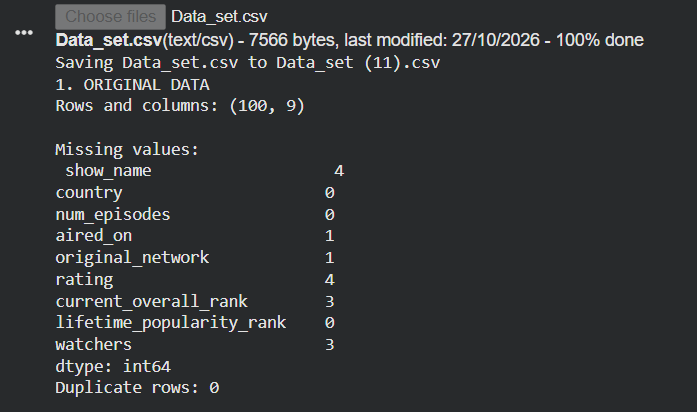
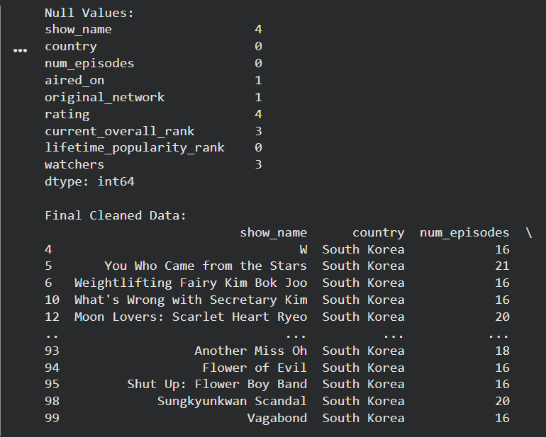
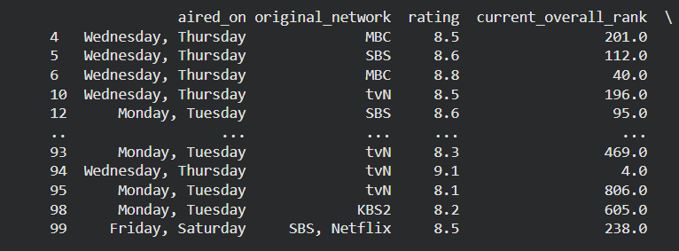
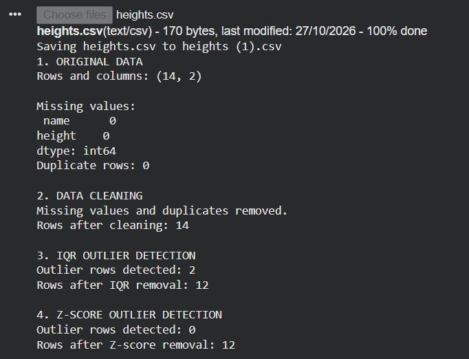
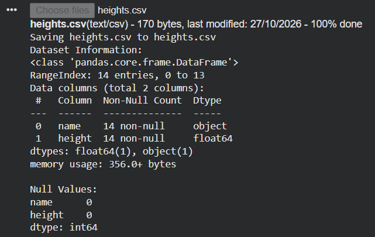

# Exno:1
Data Cleaning Process

# AIM
To read the given data and perform data cleaning and save the cleaned data to a file.

# Explanation
Data cleaning is the process of preparing data for analysis by removing or modifying data that is incorrect ,incompleted , irrelevant , duplicated or improperly formatted. Data cleaning is not simply about erasing data ,but rather finding a way to maximize datasets accuracy without necessarily deleting the information.

# Algorithm
STEP 1: Read the given Data

STEP 2: Get the information about the data

STEP 3: Remove the null values from the data

STEP 4: Save the Clean data to the file

STEP 5: Remove outliers using IQR

STEP 6: Use zscore of to remove outliers

# Coding and Output

# Data_set.csv

```

import pandas as pd
from scipy import stats
from google.colab import files

uploaded = files.upload()
filename = next(iter(uploaded))
df = pd.read_csv(filename)

print("1. ORIGINAL DATA")
print("Rows and columns:", df.shape)
print("\nMissing values:\n", df.isnull().sum())
print("Duplicate rows:", df.duplicated().sum())

df = df.dropna().drop_duplicates()
print("\n2. DATA CLEANING")
print("Missing values and duplicates removed.")
print("Rows after cleaning:", len(df))

num = df.select_dtypes(include="number")

if not num.empty:
    Q1, Q3 = num.quantile(0.25), num.quantile(0.75)
    IQR = Q3 - Q1
    iqr_outliers = ((num < Q1 - 1.5 * IQR) |
                    (num > Q3 + 1.5 * IQR)).any(axis=1)
    print("\n3. IQR OUTLIER DETECTION")
    print("Outlier rows detected:", iqr_outliers.sum())
    df = df.loc[~iqr_outliers].copy()
    print("Rows after IQR removal:", len(df))

num = df.select_dtypes(include="number")

if not num.empty and len(num) > 1:
    z = pd.DataFrame(stats.zscore(num), columns=num.columns,
                     index=num.index)
    z_outliers = (z.abs() > 3).any(axis=1)
    print("\n4. Z-SCORE OUTLIER DETECTION")
    print("Outlier rows detected:", z_outliers.sum())
    df = df.loc[~z_outliers].copy()
    print("Rows after Z-score removal:", len(df))

df.to_csv("Final_cleaned_data.csv", index=False)

print("\n5. FINAL RESULT")
print("Final dataset shape:", df.shape)
print(df.head())
print("\nFinal cleaned file saved successfully.")

files.download("Final_cleaned_data.csv")

```







# heights.csv 

```

import pandas as pd
from scipy import stats
from google.colab import files

uploaded = files.upload()
filename = next(iter(uploaded))
df = pd.read_csv(filename)

print("1. ORIGINAL DATA")
print("Rows and columns:", df.shape)
print("\nMissing values:\n", df.isnull().sum())
print("Duplicate rows:", df.duplicated().sum())

df = df.dropna().drop_duplicates()
print("\n2. DATA CLEANING")
print("Missing values and duplicates removed.")
print("Rows after cleaning:", len(df))

num = df.select_dtypes(include="number")

if not num.empty:
    Q1, Q3 = num.quantile(0.25), num.quantile(0.75)
    IQR = Q3 - Q1
    iqr_outliers = ((num < Q1 - 1.5 * IQR) |
                    (num > Q3 + 1.5 * IQR)).any(axis=1)
    print("\n3. IQR OUTLIER DETECTION")
    print("Outlier rows detected:", iqr_outliers.sum())
    df = df.loc[~iqr_outliers].copy()
    print("Rows after IQR removal:", len(df))

num = df.select_dtypes(include="number")

if not num.empty and len(num) > 1:
    z = pd.DataFrame(stats.zscore(num), columns=num.columns,
                     index=num.index)
    z_outliers = (z.abs() > 3).any(axis=1)
    print("\n4. Z-SCORE OUTLIER DETECTION")
    print("Outlier rows detected:", z_outliers.sum())
    df = df.loc[~z_outliers].copy()
    print("Rows after Z-score removal:", len(df))

df.to_csv("Final_cleaned_data.csv", index=False)

print("\n5. FINAL RESULT")
print("Final dataset shape:", df.shape)
print(df.head())
print("\nFinal cleaned file saved successfully.")

files.download("Final_cleaned_data.csv")

```




# Summary

In this experiment, I learned how to perform data cleaning using Python, Pandas, and SciPy. The datasets were imported using pd.read_csv() and analyzed to identify missing values, duplicate records, and data inconsistencies.

Missing values were identified using df.isnull().sum() and removed using df.dropna(). Duplicate records were detected using df.duplicated() and removed using df.drop_duplicates().

The IQR (Interquartile Range) method was used to detect outliers by calculating Q1, Q3, and IQR using quantile(). The Z-score method was also applied using stats.zscore() to identify values beyond the threshold of ±3. Outliers were removed using filtering conditions with df.loc[].

Finally, the cleaned datasets were saved using df.to_csv() and downloaded using Google Colab's files.download() function.


Libraries Used
- Pandas: Data loading, cleaning, manipulation, and saving.
- SciPy: Statistical calculations and Z-score analysis.
- Google Colab Files: Uploading and downloading datasets.

# Result
The given data has been successfully read, cleaned by handling duplicates and missing values, and saved to a new file.
